# Diagrama Entidad-Relacion

Este diagrama representa el modelo actual del backend. `InfoNutricional` no aparece como tabla separada porque esta embebida dentro de `Ingrediente` con `@Embedded`.

```mermaid
erDiagram
    USUARIO {
        UUID id PK
        string nombre
        string email UK
        string password
        string foto_url
        enum objetivo
        enum nivel_cocina
        enum perfil_economico
    }

    RESTRICCION_ALIMENTARIA {
        long id PK
        string nombre UK
    }

    USUARIO_RESTRICCION_ALIMENTARIA {
        UUID usuario_id FK
        long restriccion_alimentaria_id FK
    }

    INGREDIENTE {
        long id PK
        string nombre UK
        enum unidad_base
        double calorias
        double proteinas
        double carbohidratos
        double grasas
        double fibra
        double cantidad_referencia
        enum unidad_referencia
    }

    INGREDIENTE_RESTRICCION_ALIMENTARIA {
        long ingrediente_id FK
        long restriccion_alimentaria_id FK
    }

    PRECIO_INGREDIENTE {
        long id PK
        long ingrediente_id FK
        decimal precio
        decimal cantidad_referencia
        enum unidad_referencia
        date fecha_actualizacion
    }

    PREFERENCIA_INGREDIENTE_USUARIO {
        long id PK
        UUID usuario_id FK
        long ingrediente_id FK
        enum tipo_preferencia
    }

    RECETA {
        long id PK
        string nombre
        int tiempo_en_minutos
        int porciones
        enum dificultad
        string descripcion
        string img_url
    }

    RECETA_TAG {
        long receta_id FK
        string tag
    }

    RECETA_INGREDIENTE {
        long id PK
        long receta_id FK
        long ingrediente_id FK
        double cantidad
        enum unidad_medida
    }

    PASO {
        long id PK
        long receta_id FK
        int orden
        string titulo
        string descripcion
        string detalle
        int tiempo_estimado_minutos
        string tip
        string imagen_url
    }

    FAVORITO_RECETA {
        long id PK
        UUID usuario_id FK
        long receta_id FK
        datetime fecha_agregado
    }

    HISTORIAL_RECETA {
        long id PK
        UUID usuario_id FK
        long receta_id FK
        datetime fecha_inicio
    }

    USUARIO ||--o{ USUARIO_RESTRICCION_ALIMENTARIA : tiene
    RESTRICCION_ALIMENTARIA ||--o{ USUARIO_RESTRICCION_ALIMENTARIA : aplica_a

    INGREDIENTE ||--o{ INGREDIENTE_RESTRICCION_ALIMENTARIA : cumple
    RESTRICCION_ALIMENTARIA ||--o{ INGREDIENTE_RESTRICCION_ALIMENTARIA : clasifica

    INGREDIENTE ||--o{ PRECIO_INGREDIENTE : tiene_precios

    USUARIO ||--o{ PREFERENCIA_INGREDIENTE_USUARIO : configura
    INGREDIENTE ||--o{ PREFERENCIA_INGREDIENTE_USUARIO : es_preferido_o_evitado

    RECETA ||--o{ RECETA_INGREDIENTE : contiene
    INGREDIENTE ||--o{ RECETA_INGREDIENTE : participa_en

    RECETA ||--o{ PASO : se_prepara_con
    RECETA ||--o{ RECETA_TAG : etiqueta

    USUARIO ||--o{ FAVORITO_RECETA : marca
    RECETA ||--o{ FAVORITO_RECETA : es_favorita

    USUARIO ||--o{ HISTORIAL_RECETA : cocina
    RECETA ||--o{ HISTORIAL_RECETA : fue_cocinada
```

## Lectura del modelo

- `Usuario` contiene el perfil alimentario: restricciones, objetivo, nivel de cocina y perfil economico.
- `Ingrediente` contiene informacion nutricional embebida y restricciones que cumple.
- `RecetaIngrediente` existe porque la relacion entre receta e ingrediente tiene datos propios: cantidad y unidad.
- `PreferenciaIngredienteUsuario` distingue ingredientes comunes de ingredientes a evitar. Los ingredientes `COMUN` son los que el usuario suele tener en casa y se consideran disponibles para busquedas y recomendaciones. Los ingredientes `EVITAR` son los que el usuario no quiere consumir, ya sea por gusto, alergia u otra razon.
- `FavoritoReceta` e `HistorialReceta` son relaciones con datos propios, por eso no son ManyToMany directas.
- `PrecioIngrediente` permite historizar o actualizar precios sin modificar el ingrediente base.
- `RecetaTag` representa la `@ElementCollection` de tags de receta.

## Inventario del usuario para el MVP

Para el MVP no se modela una entidad separada de inventario o despensa. La fuente de verdad es `PreferenciaIngredienteUsuario`:

- `COMUN`: ingrediente que el usuario suele tener en casa. Se trata como ingrediente disponible.
- `EVITAR`: ingrediente que el usuario no quiere consumir. Se usa para penalizar o filtrar segun el caso.

Si mas adelante se necesita un inventario real con cantidad, unidad, fecha de carga o vencimiento, ahi si podria agregarse una entidad especifica. Por ahora seria duplicar informacion y complicar el modelo sin necesidad.

